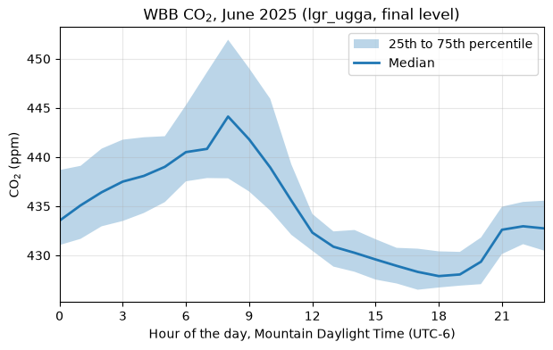

.. currentmodule:: uataq

Your first month of data
========================

.. note::

    The examples on this page read the UATAQ archive, which is only available
    on CHPC. They are shown as code and are not run when the documentation is
    built. The output under each one, and the figure, are from runs on CHPC on
    12 October 2026. If the data are reprocessed, the numbers can change a
    little.

This page takes you from an installed uataq (see :doc:`installation`) to a month
of CO2 from one site, in local time, and a plot of its daily cycle. On the way it
shows where the numbers came from: which instrument, which data level and which
research group. The example is CO2 at WBB (William Browning, on the University of
Utah campus) for June 2025, in Mountain time.

To pick a different site, pollutant or month, first check that there are data:
:doc:`what_data_exists` shows how, and :doc:`errors` says what the errors mean
when there are none.

Read a month
------------

:func:`get_obs` takes a site, a pollutant and a time range:

.. code-block:: pycon

    >>> import uataq
    >>> obs = uataq.get_obs("WBB", "CO2", time_range="2025-06")
    >>> obs
                         CO2d_ppm_cal  CO2d_ppm_raw
    Time_UTC
    2025-06-01 00:00:03    432.407511      435.5981
    2025-06-01 00:00:13    432.561390      435.7535
    2025-06-01 00:00:23    433.129237      436.3271
    2025-06-01 00:00:33    433.462976      436.6642
    2025-06-01 00:00:43    433.639127      436.8421
    ...                           ...           ...
    2025-06-30 23:59:13    427.961767      429.8449
    2025-06-30 23:59:23    427.877508      429.7600
    2025-06-30 23:59:33    427.763867      429.6455
    2025-06-30 23:59:42    427.754553      429.6361
    2025-06-30 23:59:52    427.856023      429.7383

    [250687 rows x 2 columns]

It takes a few seconds. You get one table (a pandas ``DataFrame``) with a row
about every 10 seconds. ``CO2d_ppm_cal`` is the calibrated CO2 dry mole fraction
in ppm, and ``CO2d_ppm_raw`` is the same measurement before calibration. The
column names are explained under :ref:`column-names` on the :doc:`columns` page.

This month is in **UTC**, not in local time. The next sections say where the
numbers came from, and then how to get a month in local time.

Where the numbers came from
---------------------------

When you use these data, write down the instrument, the data level and the
research group they came from, and the uataq version you used. The table does
not show them, so here is how to find each one.

The instrument
^^^^^^^^^^^^^^

:func:`get_obs` reads every instrument at the site that measures the pollutant.
To see which ones those are:

.. code-block:: pycon

    >>> wbb = uataq.get_site("WBB")
    >>> [instrument.name for instrument in wbb.pollutant_instruments["CO2"]]
    ['lgr_ugga']
    >>> print(wbb.instruments["lgr_ugga"].active_range)
    After 2013-10-09 00:00:00

So WBB's CO2 comes from one instrument, the ``lgr_ugga`` (a Los Gatos Research
greenhouse gas analyzer, which also measures CH4), installed in October 2013. A
site can have more than one instrument for a pollutant, one after another or at
the same time. :func:`get_network_obs` returns the data with an
``instrument`` column on each row, when you need to tell them apart (see
:ref:`several-sites`).

The data level
^^^^^^^^^^^^^^

The archive keeps each instrument's data at several processing levels (``raw``,
``qaqc``, ``calibrated`` and ``final``; see :ref:`input-level` and the
pipeline's
`description of the levels <https://github.com/uataq/data-pipeline#processing-levels>`_).
The ``final`` level is the ready-to-share level (it can go to people outside
the group as it is), with the pipeline's default flags applied: flagged rows are
dropped, and for the CO2 and CH4 analyzers so are the rows that measured
calibration tanks. The lower levels keep those rows, for finer control. Which
one to use depends on how clean the data need to be for what you are doing, and
on how much control you want over the QAQC.

:func:`get_obs` **always reads the final level**, so the month above is final
data. It has no ``lvl`` argument. To read another level, use :func:`read_data`,
which reads one or more instruments by name. With no ``lvl`` it reads the
highest level the instrument has, which for the ``lgr_ugga`` is ``final``:

.. code-block:: pycon

    >>> data = uataq.read_data("WBB", "lgr_ugga", time_range="2025-06-02")
    >>> data["lgr_ugga"].columns.tolist()
    ['CO2d_ppm_cal', 'CO2d_ppm_raw', 'CH4d_ppm_cal', 'CH4d_ppm_raw', 'H2O_ppm']
    >>> len(data["lgr_ugga"])
    8390

The ``qaqc`` level of the same day has every row the analyzer logged, with the
columns that say what each row is:

.. code-block:: pycon

    >>> qaqc = uataq.read_data("WBB", "lgr_ugga", lvl="qaqc", time_range="2025-06-02")["lgr_ugga"]
    >>> len(qaqc)
    8845
    >>> qaqc["QAQC_Flag"].value_counts()
    QAQC_Flag
     0    8586
    -2     259
    Name: count, dtype: int64

The 8,845 rows are the 8,390 final ones, 259 rows flagged ``-2`` and 196 rows
that measured calibration tanks. ``QAQC_Flag`` is the pipeline's flag: 0 is good
and a negative number says why a row was flagged. The pipeline's
`QAQC flag page <https://github.com/uataq/data-pipeline/blob/main/QAQC_Flags.md>`_
lists what each number means. ``ID_CO2`` marks what the analyzer was sampling:
``-10`` is the outside air. :doc:`columns` explains these columns.

The research group
^^^^^^^^^^^^^^^^^^

Each instrument's data come from one research group's archive. WBB's
``lgr_ugga`` is run by the ``lin`` group, the default (see :ref:`input-group`).
Error messages name the group that was searched, as in
``lgr_ugga in lin groupspace``.

The version
^^^^^^^^^^^

.. code-block:: pycon

    >>> uataq.__version__
    '2026.10.1.dev6+g2f5e83eb5'

Yours will differ. For results you will publish, install a fixed release (see :doc:`installation`).

Times are UTC
-------------

**Every time in uataq is UTC**: the times in the data, and the times you pass
in ``time_range`` (every form it takes is under :ref:`input-time-range`). The
index is named ``Time_UTC`` to say so, but the time zone is not attached to it
(pandas calls this a *naive* time):

.. code-block:: pycon

    >>> obs.index.name, obs.index.tz
    ('Time_UTC', None)

Salt Lake City is 6 hours behind UTC in summer (Mountain Daylight Time, MDT) and
7 hours behind in winter (Mountain Standard Time, MST). Do not subtract a fixed
number of hours. Tell pandas the times are UTC, then convert them to the
``America/Denver`` time zone, which knows when the clocks change:

.. code-block:: pycon

    >>> local = obs.tz_localize("UTC").tz_convert("America/Denver")
    >>> local.head(3)
                               CO2d_ppm_cal  CO2d_ppm_raw
    Time_UTC
    2025-05-31 18:00:03-06:00    432.407511      435.5981
    2025-05-31 18:00:13-06:00    432.561390      435.7535
    2025-05-31 18:00:23-06:00    433.129237      436.3271

The same measurements, now labeled in local time; ``-06:00`` is the offset from
UTC. (The index keeps the name ``Time_UTC``. Rename it if that confuses you:
``local.index.name = "Time_local"``.)

.. _first-month-local-month:

A month in local time
---------------------

``time_range="2025-06"`` is June in UTC. In local time that is from 18:00 on
31 May to 18:00 on 30 June:

.. code-block:: pycon

    >>> local.index[0], local.index[-1]
    (Timestamp('2025-05-31 18:00:03-0600', tz='America/Denver'), Timestamp('2025-06-30 17:59:52-0600', tz='America/Denver'))

So "June" read this way has six hours of 31 May (2,083 rows) and is missing the
last six hours of 30 June (2,081 rows), with no warning. A daily mean or a
daily cycle for the first and last day comes out wrong.

To get June in local time, **read one more day in UTC, convert, and then cut the
local month**:

.. code-block:: pycon

    >>> obs = uataq.get_obs("WBB", "CO2", time_range=["2025-06-01", "2025-07-01"])
    >>> obs = obs.tz_localize("UTC").tz_convert("America/Denver")
    >>> june = obs.loc["2025-06"]
    >>> june.index[0], june.index[-1]
    (Timestamp('2025-06-01 00:00:03-0600', tz='America/Denver'), Timestamp('2025-06-30 23:59:52-0600', tz='America/Denver'))
    >>> len(june)
    250685

The read runs to the end of 1 July in UTC (a string end includes the whole day
it names; see :ref:`input-time-range`), which covers the end of June in Mountain
time. After the conversion, ``obs.loc["2025-06"]`` picks the rows in June **local**
time, because the index now has a time zone. 30 June now has all of its 8,324
rows. Any month works the same way: start the read on the first day of the
month and end it on the first day of the next.

The daily cycle
---------------

With the month in local time, group the rows by the hour of the local day. This
script reads June, as above, and plots the median CO2 for each hour, with the
middle half of the values shaded. Save it as ``daily_cycle.py``:

.. code-block:: python

    import matplotlib.pyplot as plt

    import uataq

    # June 2025 in Mountain time: read one extra UTC day, convert, then cut
    obs = uataq.get_obs("WBB", "CO2", time_range=["2025-06-01", "2025-07-01"])
    obs = obs.tz_localize("UTC").tz_convert("America/Denver")
    june = obs.loc["2025-06"]

    # The 25th, 50th and 75th percentiles for each hour of the local day
    co2 = june["CO2d_ppm_cal"]
    by_hour = co2.groupby(co2.index.hour).quantile([0.25, 0.5, 0.75]).unstack()
    print(by_hour.round(1))

    fig, ax = plt.subplots(figsize=(7, 4))
    ax.fill_between(
        by_hour.index, by_hour[0.25], by_hour[0.75], alpha=0.3, label="25th to 75th percentile"
    )
    ax.plot(by_hour.index, by_hour[0.5], linewidth=2, label="Median")
    ax.set_xticks(range(0, 24, 3))
    ax.set_xlim(0, 23)
    ax.set_xlabel("Hour of the day, Mountain Daylight Time (UTC-6)")
    ax.set_ylabel("CO$_2$ (ppm)")
    ax.set_title("WBB CO$_2$, June 2025 (lgr_ugga, final level)")
    ax.grid(alpha=0.3)
    ax.legend()
    fig.savefig("wbb_co2_daily_cycle.png", dpi=100, bbox_inches="tight")

It needs matplotlib (``pip install matplotlib``). Hour 8 is the hour from 08:00
to 08:59 local time. The script took 8 seconds and 0.2 GB of memory, which is
fine on a login node. For more data (a year, several sites), run it in a job
(see :ref:`install-slurm`). This one was run in a Slurm job, and drew:

         about 434 ppm at midnight to a peak of 444 ppm at 8 in the morning and
         falling to a low of 428 ppm at 6 in the evening.

   CO2 at WBB in June 2025 by hour of the local day: the median (line) and the
   25th to 75th percentiles (shading), from the run above.

CO2 is highest around 08:00 local time and lowest around 18:00. Read in UTC, the
same peak would show at hour 14, and the plot would be six hours off.

Next
----

- :doc:`sites_and_instruments`: every site and instrument, what each measures,
  and what the names mean.
- :doc:`what_data_exists`: when the sites have data, and what is the newest.
- :doc:`reading_data`: the site and instrument objects, the ``long`` format,
  several sites at once, and the mobile (TRAX and bus) sites.
- :doc:`errors`: what the errors mean when a read finds nothing, and what to do.
- :doc:`columns`: what each column of each level holds, the column names, the
  ``ID`` columns, and the flags.
- :doc:`input_parameters`: what each argument of :func:`read_data` and
  :func:`get_obs` means, and every form of ``time_range``.
