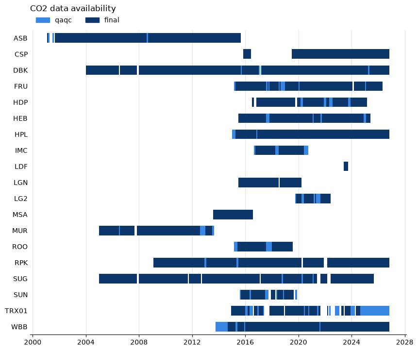

.. currentmodule:: uataq

What data exists
================

.. note::

    The examples on this page read the UATAQ archive, which is only available
    on CHPC. They are shown as code and are not run when the documentation is
    built. The output under each one is from a run on CHPC on 11 October 2026.
    The archive keeps growing, so the dates at the end of the data, and how
    long a call takes, will have moved on by the time you read this.

Before you read data, find out what there is: which sites measure your
pollutant, when they have data, and whether anything is recent. This page shows
the calls that answer those questions, and then what the errors mean when the
answer is "nothing".

.. list-table::
   :header-rows: 1
   :widths: 50 50

   * - I want to know
     - Use
   * - Which sites measure CH4?
     - ``Network("all", "CH4")``
   * - What a site measures, and since when
     - ``get_site("WBB").pollutants`` and ``.instruments``
   * - When a site has data, and at which level
     - ``Network(...).get_availability(...)``
   * - The newest data at a site
     - :func:`get_recent_obs`
   * - One pollutant from several sites in one table
     - :func:`get_network_obs`
   * - Why a read failed or came back empty
     - `When there is nothing to read`_

Which sites and pollutants
--------------------------

A site is a place where measurements are made. It has a site ID (``SID``), such
as ``WBB`` for William Browning. Some sites are fixed, like ``WBB``, and some are
mobile (the ``TRX`` and ``BUS`` sites). The :doc:`laboratory <laboratory>` lists
them all:

.. code-block:: pycon

    >>> import uataq
    >>> lab = uataq.laboratory
    >>> print(len(lab.sites), "sites")
    36 sites
    >>> lab.sites
    ['ASB', 'BUS01', 'BUS02', 'BUS03', 'BUS04', 'BUS05', 'BUS06', 'BUS07', 'BUS08', 'BUS09', 'BUS10', 'BUS11', 'BUS12', 'BUS13', 'BUS14', 'BUS15', 'CSP', 'DBK', 'FRU', 'HDP', 'HEB', 'HPL', 'IMC', 'LDF', 'LGN', 'LG2', 'MSA', 'MUR', 'ROO', 'RPK', 'SUG', 'SUN', 'TRX01', 'TRX02', 'TRX03', 'WBB']

Each site knows the pollutants it measures:

.. code-block:: pycon

    >>> wbb = uataq.get_site("WBB")
    >>> sorted(wbb.pollutants)
    ['BC', 'CH4', 'CO', 'CO2', 'NO', 'NO2', 'NOX', 'O3', 'PM2.5']

Pollutant names are upper case (``NOx`` is ``'NOX'`` here), but you can type
them in any case when you read data. To go the other way and find the sites that
measure a pollutant, make a :class:`Network` of ``"all"`` sites. A ``Network``
is a list of sites and one pollutant; it is how the package asks a question
across sites.

.. code-block:: pycon

    >>> from uataq import Network
    >>> Network("all", "CH4")
    Network(sites=['CSP', 'FRU', 'HDP', 'HPL', 'LDF', 'ROO', 'TRX01', 'WBB'], pollutant='CH4')

These lists are what the sites were set up to measure. They do not say there is
data, and they include sites and instruments that no longer run (``LDF`` and
``ROO`` have closed). An instrument has a window in which it was installed:

.. code-block:: pycon

    >>> for instrument in wbb.instruments:
    ...     print(f"{instrument.name:15} {instrument.active_range}")
    ...
    lgr_ugga        After 2013-10-09 00:00:00
    magee_ae33      After 2020-07-29 00:00:00
    metone_es642    2017-03-07 00:00:00 to 2022-06-07 00:00:00
    teledyne_t200   After 2017-01-19 00:00:00
    teledyne_t300   After 2017-05-03 00:00:00
    teledyne_t400   After 2016-08-29 00:00:00
    teledyne_t500u  2020-07-29 00:00:00 to 2023-01-25 00:00:00
    teom_1400ab     2016-09-22 00:00:00 to 2017-03-01 00:00:00

That is why ``PM2.5`` is in WBB's list although WBB's two PM2.5 instruments
(``metone_es642`` and ``teom_1400ab``) were removed years ago. The window says
when an instrument was there, not when it recorded data. For that, ask for the
availability.

When a site has data
--------------------

:meth:`Network.get_availability` tells you when sites have data for a pollutant.
Give it a time range and it returns a table with one row for each stretch of
time that has data:

.. code-block:: pycon

    >>> net = Network(["WBB", "CSP", "HDP"], "CH4")
    >>> avail = net.get_availability(["2024-01-01", None], freq="W", lvls=["final"])
    >>> avail
       SID    lvl      start       stop
    0  WBB  final 2024-01-01 2024-11-25
    1  WBB  final 2024-12-02 2026-10-19
    2  CSP  final 2024-01-01 2024-12-16
    3  CSP  final 2024-12-30 2026-10-12
    4  HDP  final 2024-01-01 2025-02-10

Each row is one site (``SID``), one data level (``lvl``) and one stretch from
``start`` up to, but not including, ``stop``. The times are UTC, like the data.
Between two rows of the same site there is a gap with no data: WBB has none for
the week starting 2024-11-25, and CSP has none for the two weeks starting
2024-12-16. HDP's last row stops on 2025-02-10, and nothing follows it: HDP has
no data after that. A site with no data in the range has no rows at all.

To get the first and last date for each site:

.. code-block:: pycon

    >>> avail.groupby("SID").agg(first=("start", "min"), last=("stop", "max"))
             first       last
    SID
    CSP 2024-01-01 2026-10-12
    HDP 2024-01-01 2025-02-10
    WBB 2024-01-01 2026-10-19

``last`` is the end of the final bin (see below), not the time of the last
measurement. With weekly bins it can be up to a week later.

Mobile sites (``TRX01`` and the others) work the same way. For an instrument
that two research groups log, the call checks both archives, so it can show data
that a read from one group would not return.

Bins
^^^^

The call cuts time into bins, one week here (``freq="W"``), and a bin counts as
having data if **any** measurement of the pollutant falls in it. So a coarse bin
hides a short gap. WBB logged no CO2 at all on 4 March 2024. Daily bins
(the default) show it, and weekly bins do not:

.. code-block:: pycon

    >>> co2 = Network(["WBB"], "CO2")
    >>> co2.get_availability("2024-03", lvls=["final"])
       SID    lvl      start       stop
    0  WBB  final 2024-03-01 2024-03-04
    1  WBB  final 2024-03-05 2024-03-24
    2  WBB  final 2024-03-25 2024-04-01
    >>> co2.get_availability("2024-03", freq="W", lvls=["final"])
       SID    lvl      start       stop
    0  WBB  final 2024-02-26 2024-04-01

The weekly row starts on 2024-02-26 because weeks start on Monday. A bin at
either end of the range can reach past it. ``freq`` is a pandas period alias:
``"D"`` (day), ``"W"`` (week) or ``"M"`` (month).

Levels
^^^^^^

By default the call checks all four data levels (``raw``, ``qaqc``,
``calibrated`` and ``final``; see :ref:`input-level`) and gives each bin the **highest** level that has data in it. A stretch labeled
``qaqc`` was therefore measured, but the final level has nothing for it. WBB
has no final CO2 for August 2021:

.. code-block:: pycon

    >>> co2.get_availability("2021", freq="M", lvls=["qaqc", "final"])
       SID    lvl      start       stop
    0  WBB  final 2021-01-01 2021-08-01
    1  WBB   qaqc 2021-08-01 2021-09-01
    2  WBB  final 2021-09-01 2022-01-01

:func:`get_obs` always reads the final level, so it has nothing to return for
that month (see `When there is nothing to read`_).

How long it takes
^^^^^^^^^^^^^^^^^

``get_availability`` opens and reads every data file in the range. That is the
only way to know a pollutant was measured: a file can exist and hold nothing for
the pollutant you asked about. It is quick for a few sites and a short range, and
slow for everything. These times are from one process on one CHPC core, for WBB
CO2:

.. list-table::
   :header-rows: 1
   :widths: 70 30

   * - Call
     - Time
   * - Two years (2024 and 2025), all four levels, daily bins (the defaults)
     - 274 s
   * - The same, with ``lvls=["final"]``
     - 9.5 s
   * - The same, with ``lvls=["final"]`` and ``freq="W"``
     - 8.1 s
   * - The year 2025 alone, one level: ``final``, ``calibrated``, ``qaqc``, ``raw``
     - 5 s, 14 s, 20 s, 80 s
   * - The defaults again, with ``num_processes=4``
     - 76 s

So:

- **Ask for the levels you need** with ``lvls``. The ``raw`` level has far more
  files than the others and takes about fifteen times as long as ``final``.
- **Give a time range.** With no ``time_range`` the call covers every year the
  site has data.
- **The bin size hardly matters** for the time. Pick it for the question.
- **Use more processes for many sites.** ``num_processes`` spreads the files
  over that many processes, and ``"max"`` uses every core you were given.
  Checking CO2 at all 19 sites that measure it, every year, final level only,
  took 73 s with ``num_processes=8``. Do this in a Slurm job, not on a login
  node.

A script that uses more than one process needs the usual ``__main__`` guard, or
Python 3.14 stops with a ``RuntimeError`` about "bootstrapping". The script
below makes the figure in the next section. Save it as ``availability.py``:

.. code-block:: python

    import uataq

    def main():
        net = uataq.Network("all", "CO2")
        avail = net.get_availability(freq="M", lvls=["qaqc", "final"], num_processes=8)
        ax = net.plot_availability(avail)
        ax.figure.savefig("co2_availability.png", dpi=100, bbox_inches="tight")

    if __name__ == "__main__":
        main()

Then submit it with the account and partition you normally use (see the
`CHPC Slurm documentation <https://www.chpc.utah.edu/documentation/software/slurm.php>`_),
from the Python environment where uataq is installed:

.. code-block:: bash

    #!/bin/bash
    #SBATCH --account=<account>
    #SBATCH --partition=<partition>
    #SBATCH --nodes=1
    #SBATCH --ntasks=1
    #SBATCH --cpus-per-task=8
    #SBATCH --mem=16G
    #SBATCH --time=00:30:00

    python availability.py

That job took 6 minutes, and the figure below is what it drew.

A picture
^^^^^^^^^

:meth:`Network.plot_availability` draws the table: a row for each site, time
along the bottom, and a bar wherever there is data, shaded by level. It needs
matplotlib. Pass it the table you already have, so a change of style does not
read the archive again.

         final level, with short qaqc-only stretches and WBB's first year as
         qaqc only.

   CO2 at every site that measures it, from the run above. Dark bars are final
   data and light bars are qaqc data with nothing in final.

The newest data
---------------

:func:`get_recent_obs` returns the last few days of a site. It reads the same
level as :func:`get_obs`, and returns the same kind of table. The default is
10 days:

.. code-block:: pycon

    >>> obs = uataq.get_recent_obs("WBB", pollutants="CO2")
    >>> print(obs.shape)
    (79370, 2)
    >>> obs.tail(3)
                         CO2d_ppm_cal  CO2d_ppm_raw
    Time_UTC
    2026-10-12 00:42:23    435.893883      438.0069
    2026-10-12 00:42:33    436.246489      438.3621
    2026-10-12 00:42:43    436.133809      438.2486

Name the pollutants. With the default ``pollutants="all"``, ten days at WBB came
back as 1.3 million rows.

``recent`` is a ``datetime.timedelta`` or any text pandas reads as a time span,
such as ``"3D"``, ``"3 days"`` or ``"12h"``:

.. code-block:: pycon

    >>> obs = uataq.get_recent_obs("WBB", recent="3D", pollutants="CO2")
    >>> print(obs.index.min(), obs.index.max())
    2026-10-09 02:15:05 2026-10-12 00:42:43

The last row is the newest data the archive holds at that level. This run was at
02:15 UTC on 12 October, and the newest WBB CO2 row was from 00:42 UTC the same
day, so the data were about an hour and a half behind. A site that has stopped
reporting has nothing recent and raises an error (HDP, under `When there is
nothing to read`_).

Several sites at once
---------------------

:func:`get_network_obs` reads one pollutant from several sites and stacks them in
one table:

.. code-block:: pycon

    >>> obs = uataq.get_network_obs(
    ...     ["WBB", "SUG", "RPK"], "CO2", time_range=["2025-06-01", "2025-06-08"]
    ... )
    >>> obs[["SID", "instrument", "CO2d_ppm_cal", "zagl"]].head(3)
                         SID instrument  CO2d_ppm_cal  zagl
    Time_UTC
    2025-06-01 00:00:03  WBB   lgr_ugga    432.407511    35
    2025-06-01 00:00:13  WBB   lgr_ugga    432.561390    35
    2025-06-01 00:00:23  WBB   lgr_ugga    433.129237    35
    >>> obs.groupby("SID").size()
    SID
    RPK    63936
    SUG    63936
    WBB    66821
    dtype: int64

The table is a ``geopandas.GeoDataFrame`` indexed by ``Time_UTC``. Besides the
concentration columns (:doc:`pollutants`) each row has the ``SID`` and
``instrument`` it came from, its position (``Latitude_deg``, ``Longitude_deg``
and ``geometry``) and ``zagl`` (height above ground level, from the site's
configuration). It reads every instrument that measures the pollutant at the
highest level the archive has for it, which is the final level for the
instruments in these examples, and it takes only one pollutant per call.
:meth:`Network.get_obs` does the same from a ``Network`` you already made.

A site with nothing in the range is left out without an error. HDP stopped in
February 2025, so asking for June 2025 returns the other two sites:

.. code-block:: pycon

    >>> obs = uataq.get_network_obs(["WBB", "HDP", "CSP"], "CO2", time_range="2025-06")
    >>> sorted(obs["SID"].unique())
    ['CSP', 'WBB']

Look at the sites you got back, or ask :meth:`Network.get_availability` first.

When there is nothing to read
-----------------------------

The archive has gaps. Sites close, instruments are removed or break, and some
months are missing. A read then raises an error or comes back empty. Each case
below says what you see, what it means and what to do.

First, turn on the log. The package reports why it skipped something as a
warning, and Python shows nothing from a library unless you ask:

.. code-block:: python

    import logging

    logging.basicConfig(level=logging.WARNING)

The log lines are shown with each case below.

No data found
^^^^^^^^^^^^^

.. code-block:: pycon

    >>> wbb.get_obs("CO2", time_range="2021-08")
    WARNING:uataq.sites:Error reading lgr_ugga@WBB data from lin groupspace: No files found within the specified time range.
    Traceback (most recent call last):
      ...
    uataq.errors.ReaderError: No data found for ['lgr_ugga'] at WBB (lgr_ugga in lin groupspace).

Nothing in the archive holds data for that instrument, in that range, at the
level that was read. ``get_obs`` and ``get_recent_obs`` read the final level.
Three cases that gave this:

- A month with no final file (WBB, August 2021, above).
- Dates after a site stopped sending data but before its instruments have a
  removal date in the configuration. Once they have one, these dates raise
  the error under `Instrument inactive`_ instead.
- Dates in the future.

The name in the brackets is the **instrument** that measures what you asked for
(``lgr_ugga`` measures CO2 and CH4), not the pollutant, and the message does not
say which dates do exist. ``lin`` is the research group whose archive was
searched (see :ref:`input-group`). When the message lists several
instruments, ``name in lin groupspace`` means it was looked for and not found,
and ``name not read: ...`` means it was skipped, with the reason.

To find the dates that do exist, use :meth:`Network.get_availability`, and add
``"qaqc"`` to ``lvls`` to see whether the instrument measured at all.

Instrument inactive
^^^^^^^^^^^^^^^^^^^

.. code-block:: pycon

    >>> wbb.get_obs("CO2", time_range="2010")
    WARNING:uataq.sites:Not reading lgr_ugga@WBB: lgr_ugga@WBB is inactive in given time_range
    Traceback (most recent call last):
      ...
    uataq.errors.ReaderError: No data found for ['lgr_ugga'] at WBB (lgr_ugga not read: lgr_ugga@WBB is inactive in given time_range).

The instrument was not installed at the site in that range. Its window is its
``active_range`` (see `Which sites and pollutants`_). A range that only touches
the window, such as one that ends the day the instrument was installed, counts
as outside it. A range that overlaps the window only in part is cut down to it,
with no error.

Dates after a site was taken down give this error too: HDP after 7 February
2025, and SUG's CO2 after 22 August 2025. That includes
``get_recent_obs("HDP", pollutants="CO2")``: nothing is recent at a site that
stopped.

Zero rows, no error
^^^^^^^^^^^^^^^^^^^

.. code-block:: pycon

    >>> wbb_obs = wbb.get_obs("CO2", time_range="2024-03")
    >>> print(len(wbb_obs))
    206114
    >>> print(len(wbb.get_obs("CO2", time_range="2024-03-04")))
    0

The month has a file, but there are no rows on that day, at any level (``raw``
too): the instrument recorded nothing. You get an empty table and no warning, so
check ``len`` of what you get back. To see where the gaps in a month are, look at
the time between rows:

.. code-block:: pycon

    >>> import pandas as pd
    >>> gaps = wbb_obs.index.to_series().diff()
    >>> gaps[gaps > pd.Timedelta("6h")]
    Time_UTC
    2024-03-05 19:29:38   2 days 06:00:42
    2024-03-20 00:42:51   0 days 22:58:15
    2024-03-25 18:02:30   2 days 14:47:56
    Name: Time_UTC, dtype: timedelta64[us]

Each row is the time the data resumed and how long the gap before it was.

One of several pollutants missing
^^^^^^^^^^^^^^^^^^^^^^^^^^^^^^^^^

.. code-block:: pycon

    >>> both = wbb.get_obs(["CO2", "O3"], time_range="2021-08")
    >>> both.columns.tolist()
    ['O3_ppb']

When you ask for several pollutants, the ones with data come back and the ones
without are dropped. There is no error, and no warning unless the log is on.
It raises ``ReaderError`` only when none of them has data. Check the columns you
got.

To go through many sites or months and skip the empty ones, catch the error:

.. code-block:: pycon

    >>> from uataq.errors import ReaderError
    >>> for sid in ["WBB", "SUG", "HDP"]:
    ...     try:
    ...         obs = uataq.get_obs(sid, "CO2", time_range="2025-06")
    ...         print(sid, len(obs), "rows")
    ...     except ReaderError:
    ...         print(sid, "has no CO2 data in June 2025")
    ...
    WBB 250687 rows
    SUG 239760 rows
    HDP has no CO2 data in June 2025

Pollutant or site not found
^^^^^^^^^^^^^^^^^^^^^^^^^^^

.. code-block:: pycon

    >>> uataq.get_obs("WBB", "NH3", time_range="2025-06")
    Traceback (most recent call last):
      ...
    ValueError: Invalid pollutant(s): '{'NH3'}'
    >>> uataq.get_obs("WBBB", "CO2", time_range="2025-06")
    Traceback (most recent call last):
      ...
    ValueError: Site 'WBBB' not found in the configuration file.

WBB does not measure NH3, or the name is misspelled; the message does not list
the valid names. Print ``sorted(site.pollutants)``. For a site, check the ID
against ``uataq.laboratory.sites``. The case does not matter for either.

``read_data`` has a similar error when you name an instrument the site does not
have (``InstrumentNotFoundError``, which lists the site's instruments).

A level the instrument does not have
^^^^^^^^^^^^^^^^^^^^^^^^^^^^^^^^^^^^

.. code-block:: pycon

    >>> uataq.read_data("WBB", "teledyne_t400", lvl="calibrated", time_range="2025-06")
    Traceback (most recent call last):
      ...
    FileNotFoundError: [Errno 2] No such file or directory: '.../wbb/teledyne_t400/calibrated'

The archive has no folder for that level for that instrument: not every
instrument has every level. Run :meth:`Network.get_availability` with the levels
you are curious about, or leave ``lvl`` out, which reads the highest level the
instrument has. A level that is not one of ``raw``, ``qaqc``, ``calibrated`` or
``final`` raises ``AssertionError: Invalid data level`` and lists the four.

Network surprises
^^^^^^^^^^^^^^^^^

.. code-block:: pycon

    >>> uataq.get_network_obs(["HDP"], "CO2", time_range="2025-06")
    WARNING:uataq.sites:Error reading lgr_ugga@HDP data from lin groupspace: No files found within the specified time range.
    WARNING:uataq.network:Error reading data from HDP: No data found for ['lgr_ugga'] at HDP (lgr_ugga in lin groupspace).
    Traceback (most recent call last):
      ...
    uataq.errors.ReaderError: No data found for CO2 in any site.

None of the sites had data in the range. The log says why for each site.

.. code-block:: pycon

    >>> Network(["WBB", "WBBB"], "CO2")
    WARNING:uataq.network:Site 'WBBB' not found: Site 'WBBB' not found in the configuration file.
    Network(sites=['WBB'], pollutant='CO2')
    >>> Network(["WBBB"], "CO2")
    Traceback (most recent call last):
      ...
    ValueError: No sites found that measure pollutant 'CO2'. Valid sites: ['WBBB']

A misspelled site, or a site that does not measure the pollutant, is dropped from
a ``Network`` without an error, and only the log tells you. Print the
``Network`` to see the sites it kept. If none is left you get the second error,
whose "Valid sites" is just the list you typed, not a list of valid sites. Use
``Network("all", "CO2")`` to see the real ones. List each site once: a site
named twice is read twice, and its rows come back twice.

If the error is about ``time_range`` itself, see :ref:`input-time-range`.

Reference
---------

.. autofunction:: get_recent_obs

.. autofunction:: get_network_obs

.. autoclass:: Network
